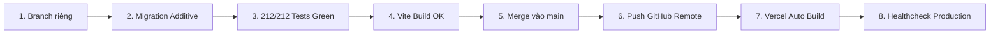

# PRODUCTION DEPLOYMENT & OPERATION PLAYBOOK (DEPLOY.md)
> Hướng dẫn triển khai, kiểm toán an ninh, sao lưu và phục hồi dữ liệu hệ thống CRM Broker Platform.

---

## 1. THÔNG SỐ MÔI TRƯỜNG PRODUCTION

| Dịch vụ | Định danh / URL | Ghi chú |
| :--- | :--- | :--- |
| **Git Remote** | `https://github.com/Jamesrealonline/CRM-Broker-Deploy.git` | Branch chính: `main` |
| **Vercel Production** | Project ID: `prj_cb5cpWduAzlUjbaQftkOm83UeIZm` | Auto-deploy khi push vào branch `main` |
| **Supabase Database** | Project Ref: `qgwclprivwctxpyduxyu` (`https://qgwclprivwctxpyduxyu.supabase.co`) | PostgreSQL 15, RLS, Vault, pgcrypto |
| **Múi giờ vận hành** | `Asia/Ho_Chi_Minh` (UTC+7) | Cưỡng chế hiển thị và tính toán SLA/Kỳ báo cáo |
| **Đơn vị tiền tệ** | VNĐ (`numeric(18,0)`) | Tròn đồng, không làm tròn số học gây lệch sổ cái |

---

## 2. QUY TRÌNH DEPLOY AN TOÀN (ZERO DOWNTIME)



### Bước 1: Kiểm thử cục bộ
1. Chạy toàn bộ test suite:
   ```bash
   npm test
   # Kết quả bắt buộc: 26/26 test files passed, 212/212 tests passed
   ```
2. Kiểm tra type và đóng gói sản phẩm:
   ```bash
   npx tsc --noEmit
   npm run build
   # Kết quả: dist/assets được sinh thành công, 0 lỗi TypeScript
   ```

### Bước 2: Triển khai Database Migration
- File migration: `supabase/migrations/026_admin_director_full_access_and_sample_data.sql`
- Script khôi phục (Rollback): `supabase/migrations/rollback/026_rollback_admin_director_full_access_and_sample_data.sql`
- Đảm bảo migration 100% additive:
  - Thêm cột `is_sample` (mặc định `false`) vào `leads`, `customers`, `transactions`, `profiles`.
  - Thêm cột `employment_type` vào `profiles` với giá trị mặc định `'official'`.
  - Cập nhật hàm RPC `get_unmasked_customer_pii` (kiểm tra `admin` hoặc `director` thuộc sàn).
  - Khởi tạo RPC `seed_sample_leads_data` và `purge_sample_data`.

### Bước 3: Đồng bộ Git & Kích hoạt Vercel Deploy
```bash
git checkout main
git merge feat/admin-full-access-kpi-hr
git push origin main
```

---

## 3. QUY TRÌNH SAO LƯU & PHỤC HỒI THỜI ĐIỂM (PITR)

### 3.1. Sao lưu định kỳ (Database Backup)
- Supabase tự động sao lưu Physical Backup hằng ngày và lưu trữ WAL (Write-Ahead Logs) cho Point-in-Time Recovery (PITR).
- Sao lưu Logical Backup thủ công trước mỗi đợt nâng cấp lớn:
  ```bash
  supabase db dump --project-ref qgwclprivwctxpyduxyu -f backup_$(date +%Y%m%d_%H%M%S).sql
  ```

### 3.2. Quy trình Rollback khẩn cấp
Nếu xảy ra sự cố không tương thích trên Production:
1. **Frontend Rollback:** Trên Vercel Dashboard, chuyển đổi Instant Rollback về deployment commit trước đó (chỉ mất ~5 giây).
2. **Database Rollback:** Chạy script khôi phục:
   ```sql
   -- Thực thi file supabase/migrations/rollback/026_rollback_admin_director_full_access_and_sample_data.sql
   ```
3. **Phục hồi Thùng rác:** Toàn bộ dữ liệu bị xóa mềm vẫn nằm nguyên trong `trash_bins` hoặc các bản ghi có cờ `deleted_at`, có thể khôi phục tức thì qua giao diện Admin `/admin` tab "Thùng rác".

---

## 4. DANH MỤC BIẾN MÔI TRƯỜNG PRODUCTION

| Tên biến | Mục đích | Bắt buộc |
| :--- | :--- | :---: |
| `VITE_SUPABASE_URL` | Endpoint kết nối Supabase API | Có |
| `VITE_SUPABASE_ANON_KEY` | Public key phía Client có kiểm soát RLS | Có |
| `SUPABASE_SERVICE_ROLE_KEY` | Khóa đặc quyền Server-side (Chỉ lưu trên Server/Vercel Backend) | Có |
| `RESEND_API_KEY` | Khóa gửi email thông báo tự động (Supabase Vault) | Có |
| `ENCRYPTION_KEY` | Khóa mã hóa CCCD và PII nhạy cảm (pgcrypto) | Có |
